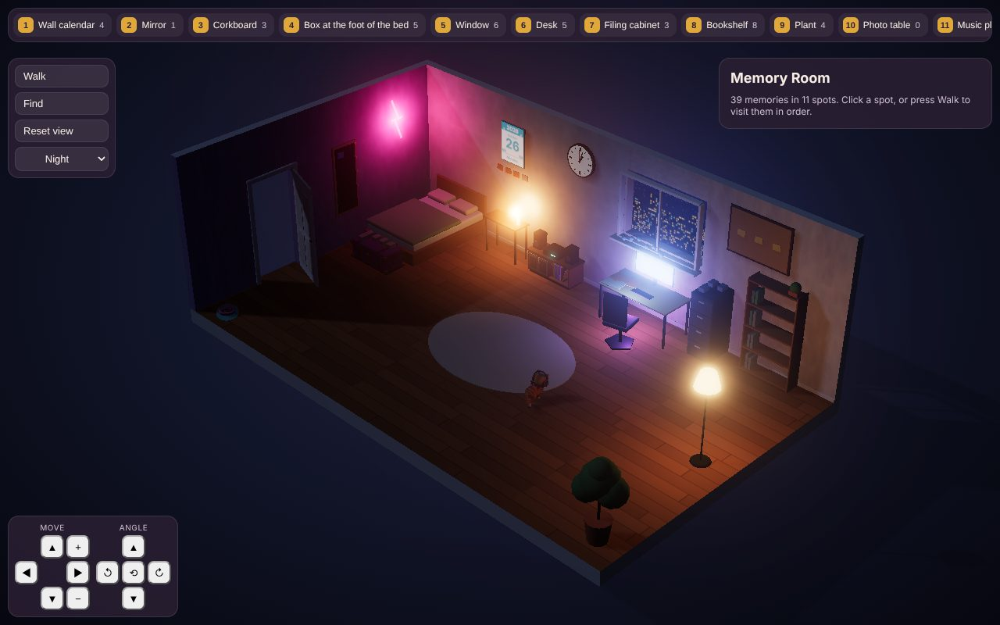
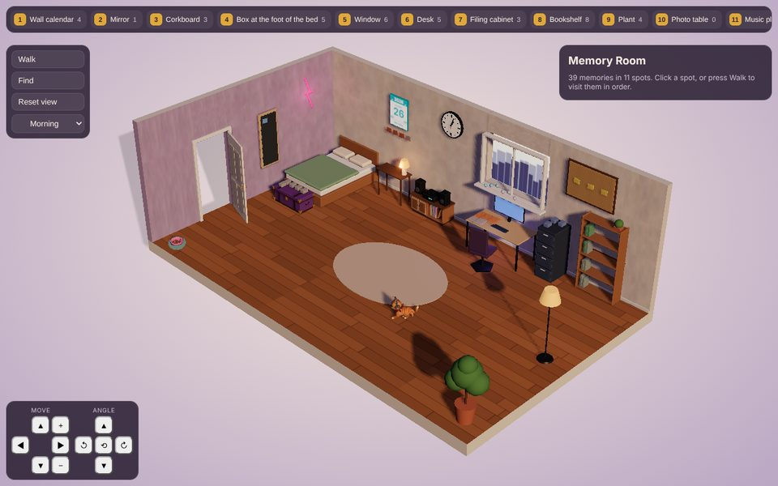
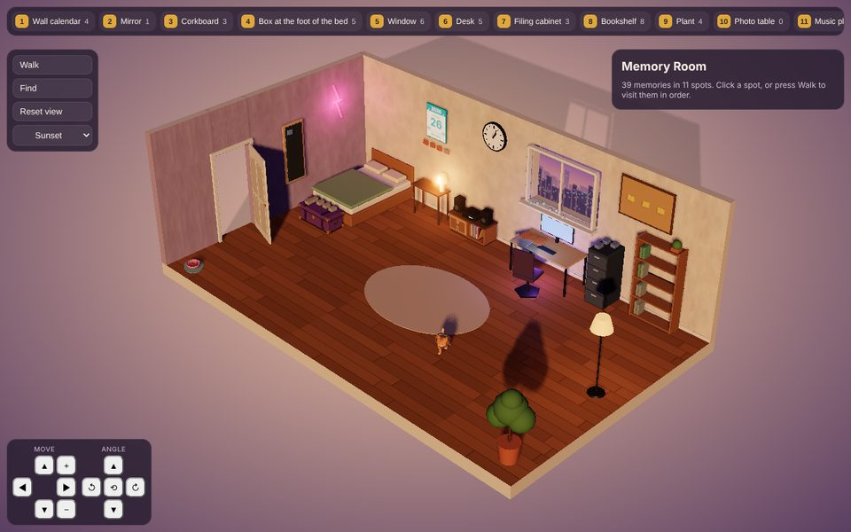
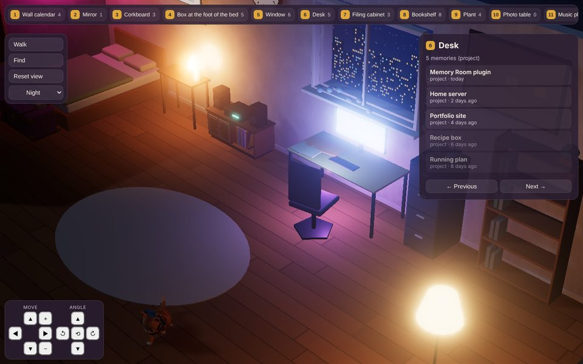
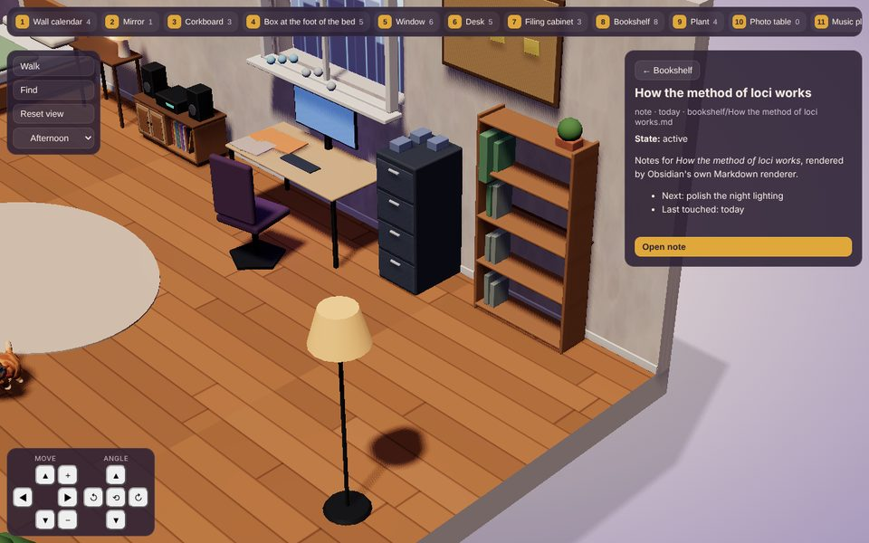
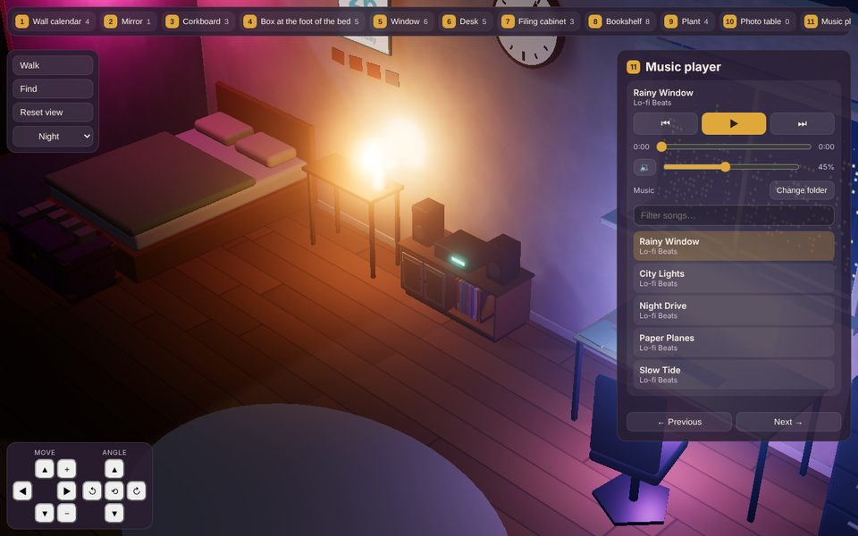
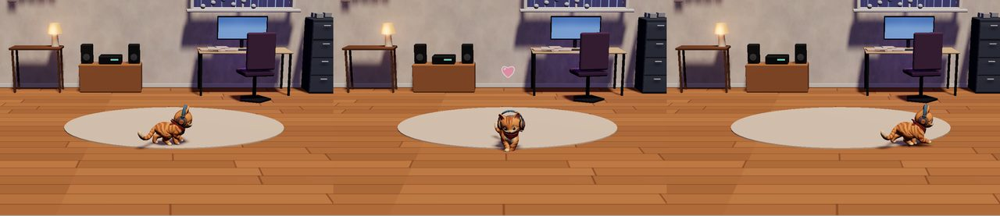
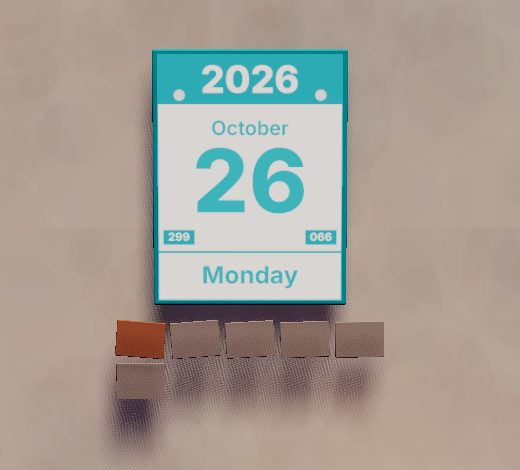

# Memory Room for Obsidian (beta)

Your vault as a cozy 3D room. Every note becomes an object on one of 11 spots, and you walk the
spots in a fixed order, like a memory palace. Built with Three.js; it runs inside Obsidian, beside
your normal editor.

**[Try the live demo](https://aceattacker77.github.io/Obsidian-memory-room/)** in your browser, with a
made-up sample vault. Nothing to install, and nothing leaves your browser.



## Objective: another way into the same notes
Obsidian shows a vault as a file tree, a list of tabs and a graph. Memory Room is an alternative
front end for that same vault: a place you can look at. Projects sit on the desk, reading notes fill
the bookshelf, daily notes grow on the plant and old things go in the box at the foot of the bed.

Nothing is copied or converted. The room reads your Markdown files where they are, refreshes when
they change, and hands every note back to Obsidian to open, preview and edit. Close the room and
your vault is exactly as it was.

## Theme: a memory palace you can walk
The idea comes from the method of loci: you remember things better when they have a place, and you
visit the places in the same order every time. Memory Room is a small lived-in bedroom-study, seen as
a cut-away diorama on a soft gradient backdrop. The light follows your computer's clock, a wall clock
and a tear-off calendar keep the date, and a ginger tabby in headphones wanders the floor.

Folders decide where a note goes. The walk order is fixed, so the room always reads the same way:

| # | Spot | Default source |
|---|---|---|
| 1 | Wall calendar | `reviews/` |
| 2 | Mirror | `identity/USER.md` |
| 3 | Corkboard | `missions/`, `open-questions.md` |
| 4 | Box at the foot of the bed | `archive/` |
| 5 | Window | `keep/` (things you keep an eye on) |
| 6 | Desk | `projects/<name>/STATUS.md`, one per project |
| 7 | Filing cabinet | `decisions/` |
| 8 | Bookshelf | `notes/` |
| 9 | Plant | `daily/`, `logs/` |
| 10 | Photo table | Meant for your picture folder (people, pets). For now it holds notes with `room-spot: photo_table` or a `person`/`photo` folder rule, shown as blank frames |
| 11 | Music player | Songs from your Music folder |

These are the default folder rules. Change them in the plugin settings to fit your vault, or give
one note a `room-spot` property to put it on any spot.

## Light: the room follows your day
By default the light follows your computer's clock, fading from night to morning, afternoon, sunset
and back. You can also hold one light (morning, afternoon, sunset or night, with neon, LED and lamp
glow). The choice is remembered.

| Morning | Sunset |
|---|---|
|  |  |

## Features
- **Memories from your vault:** notes are placed by folder rule, newest first. Anything untouched for
  5 days fades, so you can see what needs attention. The room updates live when you create, move or
  delete notes.
- **Open a spot, then a note:** click a spot in the room or the top bar. The side panel lists its
  memories; click one for a rendered preview and **Open note**.
- **Native Obsidian behaviour:** Ctrl-click, Ctrl-Alt-click and middle-click open notes like any
  link. Ctrl-hover shows Obsidian's page preview. Right-click gives the normal file menu.
- **Move around:** drag to rotate and scroll to zoom. The arrow pad (bottom left) slides, zooms,
  turns and tilts the view, and its middle button resets; hold a button to keep going. In the room,
  ← and → walk the spots, Esc resets and / finds.
- **Music player:** plays mp3, m4a, aac, flac, wav, ogg and opus from your Music folder (or any
  folder you set) and its sub-folders. Play, pause, skip, seek, volume, mute, filter and Change
  folder. It keeps playing when you leave the room, with the song in the status bar. Desktop only.
- **DJ Whiskers, the pet cat:** a rigged ginger tabby in headphones who wanders the open floor, sits,
  and every few walks goes to her dish by the door to eat. Click her and she turns to face you and
  waves, with a heart, then carries on where she was going. She can be switched off in settings.
- **Calendar and clock:** a tear-off page shows today's year, month, day, weekday, day of the year,
  days left and any holiday, with review notes hanging in a row under it. The wall clock keeps your
  computer's time, second hand included.
- **Review fading memories:** a daily tidy. Go through notes past the fade window and Open, Touch
  (sets `last-touched`) or Archive each one. Archiving moves it to `archive/` and updates links.
  STATUS files are open-only.
- **Small touches:** the door swings shut when you click it, and again to open it. The room only
  draws while it is on screen, so it does not drain a laptop in a background tab.

## Screenshots
| | |
|---|---|
|  |  |
| Desk at night. Older projects in the panel are faded because nobody has touched them for 5 days. | A note preview from the bookshelf, with **Open note**. |
|  |  |
| The music player spot: controls, volume, folder and a filterable song list. | Click DJ Whiskers: she turns, waves with a heart, then carries on. (Taken inside Obsidian.) |



The tear-off calendar: 299 is the day of the year and 066 the days left. Review notes hang in a row
below it.

Room screenshots use a small sample vault and were rendered with the plugin's own room and panel
code. The cat and calendar shots were taken inside Obsidian.

## Install the beta with BRAT
Memory Room is in beta and not yet in Obsidian's community plugin list. BRAT installs it straight
from GitHub and keeps it updated.

1. In Obsidian, open Settings → Community plugins → Browse, then install and enable **BRAT**
   (Obsidian42 - BRAT).
2. Open the command palette (Ctrl/Cmd-P), run **BRAT: Add a beta plugin for testing** and enter
   `aceattacker77/obsidian-memory-room`.
3. Enable **Memory Room** in Settings → Community plugins.
4. Open it from the armchair icon in the ribbon, or with the command **Memory Room: Open Memory Room**.

The first time the room opens, it downloads the cat's model (`cat.glb`, about 6 MB) from this repo's
release into the plugin folder. After that it works offline.

**Manual install:** download `main.js`, `manifest.json`, `styles.css` and `cat.glb` from the
[latest release](https://github.com/aceattacker77/Obsidian-memory-room/releases) and put them in
`<vault>/.obsidian/plugins/memory-room/`. Then reload Obsidian and enable the plugin.

### Before you start
- The default rules expect folders like `projects/`, `notes/`, `daily/`, `decisions/`, `reviews/`,
  `archive/` and `keep/`. Change them under Folder rules in the plugin settings.
- The music player is desktop only. On phones the room loads, but it is heavy and has no pinch zoom yet.
- Requires Obsidian 1.7.2 or newer.

## Commands (Ctrl/Cmd-P, all can take hotkeys)
| Command | What it does |
|---|---|
| Open / Open in new window / Open in right sidebar | Opens the room |
| Find a memory | Obsidian's fuzzy finder over the room; Enter shows it in the room, Ctrl-Enter opens the note |
| Go to spot 1..11 | One command per spot |
| Walk to the next / previous spot, Reset view | While the room is active |
| Show current note in the room | Also in the file and editor right-click menus as "Show in Memory Room" |
| Put current note on a spot… | Sets or removes the `room-spot` property |
| New memory on a spot… | Creates a note in that spot's folder (or notes/ with `room-spot`), from the template in settings if set |
| Music: Play or pause / Next song / Previous song / Play a song… / Volume up / Volume down / Mute or unmute / Choose music folder… / Rescan music folder | |
| Set light: Morning / Afternoon / Sunset / Night / Your time | Your time follows the clock |
| Review fading memories | Open, Touch or Archive notes past the fade window |

## Technical details
- Written in TypeScript. The 3D room uses Three.js 0.186 with shadows, bloom for the night glow and
  a perspective camera with a long lens.
- Bundled with esbuild into a single `main.js`. Tested with Vitest (28 tests on how notes become
  memories).
- The room and panel are plain DOM. Everything Obsidian does natively (opening notes, hover
  previews, the file menu, Markdown rendering, the fuzzy finder) is handed back to Obsidian.
- DJ Whiskers is a rigged glTF model made in Meshy, with walk, idle and wave clips on one skeleton
  and a 1K texture (`cat.glb`, shipped next to `main.js`).
- Works on desktop and mobile (`isDesktopOnly: false`); minimum Obsidian 1.7.2. Plugin id `memory-room`.

## Still to come
Memory Room started as a cozy Godot game. These parts have not been carried over to the plugin yet:
the avatar and free roam, decorating and the furniture catalogue, your own memories, the trash bin,
daily mail, photo sources and add-on packs. Photo sources are what the photo table is for: point it
at your pictures folder and see your people and pets in its frames. For now the room reads only
Markdown notes, so image files do not show up there yet.

Please report bugs and ideas in [Issues](https://github.com/aceattacker77/Obsidian-memory-room/issues).

## Develop
```
npm install
npm test        # vitest
npm run build   # typecheck + bundle to main.js
```

The live demo is `docs/index.html`, served by GitHub Pages from the `docs/` folder. Its source is in
`demo/`; rebuild it after a release with `node demo/build.mjs path/to/cat.glb docs/index.html`.

## License
MIT. By Ace Attacker. DJ Whiskers was made with Meshy.
