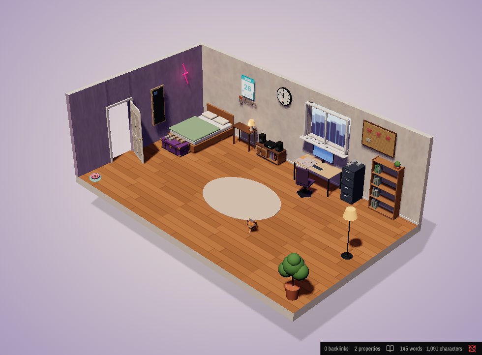

# Memory Room for Obsidian (beta)

Your vault becomes a cozy 3D room: every note is an object on one of 11 spots, walked in a fixed
order like a memory palace. Built with Three.js; runs inside Obsidian.



## What it does
- **The room:** a cut-away diorama on a soft gradient backdrop, seen from the open corner. Drag to
  rotate, scroll to zoom. It only draws while it is on screen.
- **Memories from the vault:** folders map to kinds, kinds to spots (projects → desk, notes →
  bookshelf, daily notes → plant, decisions → filing cabinet, archive → box at the foot of the bed,
  Keep → window, reviews → wall calendar, questions and missions → corkboard, identity → mirror). A `room-spot` property puts one note on any spot. Newest first; anything
  untouched for 5 days fades.
- **Open a spot** from the top bar or by clicking it; the panel lists its memories. Click one for a
  rendered preview and **Open note**. Ctrl-click, Ctrl-Alt-click and middle-click open notes like any
  Obsidian link; Ctrl-hover shows Obsidian's page preview; right-click gives the file menu.
- **Arrow pad** (bottom left): Move arrows slide the view, + and − zoom; Angle arrows turn left and right, tilt up and down, and the middle button resets. Hold a button to keep going.
- **Door:** click it to swing it shut, click again to open it.
- **Keys in the room:** ← and → walk, Esc resets, / finds.
- **Light:** follows your computer's clock by default, fading from night to morning, afternoon, sunset and back; or hold morning, afternoon, sunset or night (neon, LED and lamp glow). Remembered.
- **Music player:** plays songs from your Music folder (or any folder you set) and its sub-folders: mp3, m4a, aac, flac, wav, ogg, opus. Play, pause, skip, seek, volume and mute, filter, and Change folder (a folder dialog) from the music player spot; it keeps playing when you leave the room, with the song in the status bar. Desktop only.
- **Pet cat:** DJ Whiskers, a ginger tabby in headphones (made and rigged in Meshy with its four-legged walk, plus idle and wave clips added on the same skeleton, 1K texture; `cat.glb`, shipped next to `main.js`), wanders the open floor, sits, and every few walks goes to her food dish by the doorway wall to eat. Click her and she turns to face you, lifts a front paw to wave with a heart popping up, then carries on where she was going. Turn it off in settings.
- **Wall calendar:** a tear-off day page for today (year, month, day, day of the year, days left, holiday, weekday); review notes hang in a row under it.
- **Wall clock:** shows the time on your computer, second hand included.

### Commands (Ctrl/Cmd-P, all can take hotkeys)
| Command | |
|---|---|
| Open / Open in new window / Open in right sidebar | |
| Find a memory | Obsidian's fuzzy finder over the room; Enter shows it in the room, Ctrl-Enter opens the note |
| Go to spot 1..11 | One command per spot |
| Walk to the next / previous spot, Reset view | While the room is active |
| Show current note in the room | Also in the file and editor right-click menus as "Show in Memory Room" |
| Put current note on a spot… | Sets or removes the `room-spot` property |
| New memory on a spot… | Creates a note in that spot's folder (or notes/ with `room-spot`), from the template in settings if set |
| Music: Play or pause / Next song / Previous song / Play a song… / Volume up / Volume down / Mute or unmute / Choose music folder… / Rescan music folder | |
| Set light: Morning / Afternoon / Sunset / Night / Your time | |
| Review fading memories | Open, Touch (sets `last-touched`) or Archive (moves to archive/, links updated). STATUS files are open-only |

Not carried over from the Godot build (yet): the avatar and free roam, decorating and the furniture
catalogue, own memories, trash, daily mail, photo sources and add-on packs.

## Install the beta with BRAT
1. In Obsidian, install and enable **BRAT** (Obsidian42 - BRAT) from Community plugins.
2. Run the command **BRAT: Add a beta plugin for testing** and enter `aceattacker77/obsidian-memory-room`.
3. Enable **Memory Room** in Settings → Community plugins, then open it from the ribbon or the
   command **Memory Room: Open Memory Room**.

The cat's model (`cat.glb`, about 6 MB) is downloaded from this repo's release the first time the
room opens. To install by hand instead, copy `main.js`, `manifest.json`, `styles.css` and `cat.glb`
from the latest release into `<vault>/.obsidian/plugins/memory-room/`.

## Beta notes
- The music player is desktop only. On phones the room loads, but it is heavy and has no pinch zoom yet.
- The default folder rules expect folders like `projects/`, `notes/`, `daily/`, `decisions/`,
  `reviews/`, `archive/` and `keep/`. Change them in the plugin settings (Folder rules) to fit your vault.
- Please report bugs and ideas in Issues.

## Develop
```
npm install
npm test        # vitest
npm run build   # typecheck + bundle to main.js
```

## License
MIT. DJ Whiskers was made with Meshy.
